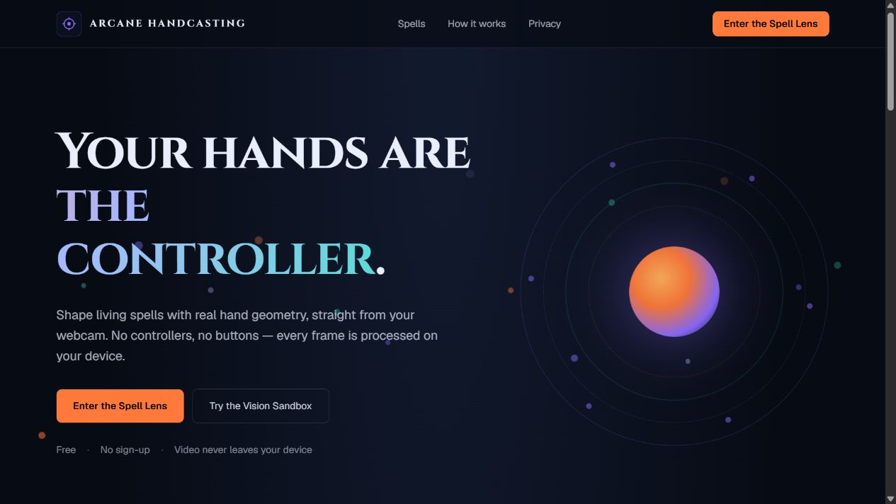
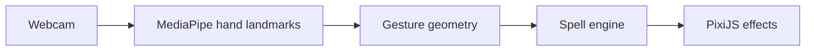

<div align="center">

# 🧙 Arcane Hand Casting

**Cast browser spells with real-time hand tracking.**

[](https://nextjs.org/)
[](https://www.typescriptlang.org/)
[](https://developers.google.com/mediapipe)
[](https://vitest.dev/)
[](https://tailwindcss.com/)

**[Open live project](https://arcane-hand-casting.vercel.app/)**



<sub>Live landing page; camera access is needed to use the arena.</sub>

</div>

---

## 📋 Contents

- [Overview](#-overview)
- [Key Capabilities](#-key-capabilities)
- [Architecture](#-architecture)
- [Tech Stack](#-tech-stack)
- [Getting Started](#-getting-started)
- [Verification](#-verification)
- [Repository Layout](#-repository-layout)
- [Spells](#-spells)
- [Privacy](#-privacy)
- [Deploy](#-deploy)
- [Documentation](#-documentation)

---

## 💡 Overview

A real-time computer vision spellcasting arena powered by webcam hand tracking, MediaPipe WASM landmark detection, custom particle renderers, and interactive physics. Cast magic spells in 3D space using natural hand gestures.

---

## ✨ Key Capabilities

- **Real-Time MediaPipe Hand Tracking**: Integrates Google MediaPipe WASM (`hand_landmarker.task`) for low-latency 21-keypoint 3D hand tracking directly in the browser via webcam.
- **Gesture-Based Spell Mechanics**: Detects pinch, palm facing, finger beam pointing, and motion vectors to cast distinct spells (Void Singularity, Storm Weave, Aegis Ward, Ember Grasp).
- **Custom Canvas & Particle Renderers**: High-performance visual effects rendered via custom specialized renderers (`AegisRenderer`, `LightningRenderer`, `CameraFireballRenderer`, `EmberFistRenderer`, `TrialRenderer`).
- **Landmark Smoothing & Calibration**: Temporal landmark smoothing algorithms (`landmarkSmoother.ts`) and interactive user camera calibration to prevent tracking jitter.
- **Interactive Arena & Vision Sandbox**: Practice mode (`/sandbox`) with live debug landmark overlays (`drawDebugOverlay.ts`) and full-fledged gameplay arena (`/arena`).

---

## 🏗️ Architecture



---

## 🧱 Tech Stack

| Layer | Technology |
|---|---|
| Framework | next ^16.3.1 |
| UI | react ^19.0.0 |
| Rendering | pixi.js ^8.9.0 |
| Hand tracking | @mediapipe/tasks-vision ^0.10.22 |

---

## 🚀 Getting Started

### Prerequisites

- **Node.js**: `v18.0.0+`
- **npm** or **pnpm**
- **Webcam**: Required for real-time hand gesture tracking.

---

### Local Development Setup

1. **Clone the repository**:
   ```bash
   git clone https://github.com/ZenzerJs/Arcane-Hand-Casting.git
   cd Arcane-Hand-Casting
   ```

2. **Install dependencies & copy MediaPipe WASM assets**:
   ```bash
   npm install
   npm run copy:mediapipe
   ```

3. **Run the development server**:
   ```bash
   npm run dev
   ```

4. **Open Application**:
   Navigate to [http://localhost:3000](http://localhost:3000) and grant camera permissions when prompted.

Open [http://localhost:3000](http://localhost:3000):

- `/arena` — live spells + trial mode
- `/sandbox` — vision debug overlay (landmarks, FPS, inference ms)

---

## 🧪 Verification

Run the Vitest unit test suite to verify vision normalization, landmark smoothing, and spell mechanics:

```bash
npm run test
```

| Command | Action |
| :--- | :--- |
| `npm run dev` | Launches Next.js dev server with hot reload |
| `npm run build` | Compiles Next.js production build |
| `npm run test` | Runs Vitest unit tests for vision and spell engines |
| `npm run lint` | Runs ESLint for code style enforcement |

---

## 📁 Repository Layout

```text
Arcane-Hand-Casting/
├── app/                      # Next.js App Router (/arena, /sandbox, /)
│   ├── arena/                # Full spellcasting battle arena page
│   ├── sandbox/              # Computer vision testing & debugging sandbox page
│   ├── globals.css           # Custom HUD & arcane theme styles
│   ├── page.tsx              # Landing page
│   ├── robots.ts             # robots.txt directives
│   ├── sitemap.ts            # Dynamic sitemap
│   ├── icon.svg              # Favicon
│   └── opengraph-image.tsx   # Generated OpenGraph share card
├── components/               # React UI overlays & HUD components
│   ├── ArenaView.tsx         # Main gameplay arena wrapper
│   ├── HandArenaView.tsx     # Camera + Pixi spell render layer
│   ├── CameraPermission.tsx  # WebCam stream permission handler
│   ├── TutorialOverlay.tsx   # First-run spell tutorial
│   └── VisionSandbox.tsx     # Live landmark debug canvas component
├── game/                     # Core game engine, renderers, & spell mechanics
│   ├── config/               # Spell definitions & tunable thresholds
│   ├── render/               # WebGL/Canvas visual effect renderers
│   ├── spells/               # Spell selection & gesture routing
│   └── trial/                # Wave-based trial mode logic
├── vision/                   # Computer vision processing engine
│   ├── handLandmarker.ts     # MediaPipe WASM initialization & frame processing
│   ├── landmarkSmoother.ts   # Exponential smoothing & jitter reduction
│   ├── palmFacing.ts         # Palm orientation & vector calculation
│   ├── viewport.ts           # object-cover coordinate transform
│   ├── handOrder.ts          # Stable hand ordering across frames
│   └── drawDebugOverlay.ts   # Debug skeleton & landmark visualizer
├── docs/                     # Specifications (SPELL_SPEC, HAND_FEATURES, COORDINATES)
└── public/models/            # MediaPipe hand landmarker WASM model binary
```

---

## 🪄 Spells

| Spell | Gesture | Effect |
|---|---|---|
| Void Singularity | Two open palms stacked vertically, pull apart | Black hole with orange/violet event horizon; consumes trial wisps |
| Storm Weave | Hands side by side, fingers spread | Five tip↔tip lightning arcs; strikes trial wisps |
| Aegis Ward | One steady open palm toward camera | Rotating rune ward; blocks diving hazard bolts |
| Ember Grasp | One closed fist toward camera | Molten embers burn trial wisps that drift close |

### Trial mode

Press **Begin trial** on `/arena`. Rune wisps drift across the frame — destroy them with the singularity, lightning, or embers. Hazard bolts dive toward the bottom of the frame; block them with the Aegis ward or lose one of three lives. Waves grow each clear.

---

## 🔒 Privacy

Webcam frames are processed **locally in the browser**. This MVP does not upload, save, or store camera video.

---

## 📦 Deploy

Standard Next.js app — push to GitHub and import into [Vercel](https://vercel.com/new). No environment variables required; the MediaPipe model loads client-side.

---

## 📜 Documentation

Detailed technical design specs are located in `/docs`:
- [`SPELL_SPEC.md`](docs/SPELL_SPEC.md) — Gesture patterns and spell parameters
- [`HAND_FEATURES.md`](docs/HAND_FEATURES.md) — Feature extraction algorithms
- [`COORDINATES.md`](docs/COORDINATES.md) — Normalized screen vs. 3D landmark mapping

<div align="center">

*Built by [ZenzerJs](https://github.com/ZenzerJs) & [Somerandomdev-ui](https://github.com/SOmerandomdev-ui)*

</div>
